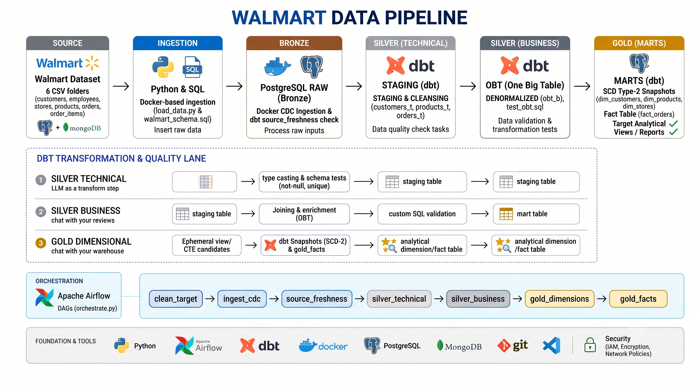

<div align="center">

# Walmart Data Pipeline

### From raw retail data to analytics-ready insights.

An end-to-end data engineering pipeline built to ingest, validate, transform, and model Walmart retail data. Uses Apache Airflow for workflow orchestration, dbt for data transformation and quality testing, and Docker Compose for containerized deployment.

<p>
  
  
  
  
  
</p>

</div>

---

## About the Project

The Walmart Data Pipeline processes retail datasets containing customers, employees, stores, products, orders, and order items.

The pipeline follows a medallion-inspired architecture, transforming raw source data into standardized technical models, enriched business models, and analytical fact and dimension tables.

Apache Airflow orchestrates the workflow, while dbt handles transformations, source freshness checks, schema tests, and historical tracking through Slowly Changing Dimension Type 2 (SCD Type 2) snapshots.

## Features

- **Data Ingestion:** Load retail datasets and process change data capture (CDC).
- **Workflow Orchestration:** Automate pipeline execution using Apache Airflow DAGs.
- **Data Transformation:** Clean, standardize, and enrich source data using dbt.
- **Medallion Architecture:** Organize transformations into technical, business, and gold layers.
- **Dimensional Modeling:** Build fact tables and dimension models for analytics.
- **SCD Type 2 Snapshots:** Track historical changes in selected data attributes.
- **Data Quality Testing:** Validate uniqueness, non-null constraints, and referential integrity.
- **Source Freshness:** Check source data freshness before downstream transformations.
- **Reusable SQL Logic:** Use dbt ephemeral models and Jinja for reusable transformations.
- **Containerized Environment:** Run services using Docker and Docker Compose.

## Tech Stack

| Technology                                               | Purpose                                       |
| -------------------------------------------------------- | --------------------------------------------- |
| Python 3                                                 | Pipeline orchestration and supporting scripts |
| SQL                                                      | Data transformation and modeling              |
| Apache Airflow                                           | Workflow orchestration                        |
| dbt                                                      | Data transformation, modeling, and testing    |
| PostgreSQL                                               | Relational database support                   |
| Snowflake / Redshift / BigQuery-compatible architectures | Data warehouse integration options            |
| Jinja                                                    | Reusable SQL templates                        |
| Docker                                                   | Containerization                              |
| Docker Compose                                           | Multi-service deployment                      |

## How It Works

1. **Data Ingestion:** Load retail datasets containing customers, employees, stores, products, orders, and order items.
2. **Source Freshness:** Verify that source data is sufficiently up to date.
3. **Technical Transformation:** Standardize column names, cast data types, and apply basic constraints.
4. **Business Transformation:** Build enriched, denormalized business models using the One Big Table (OBT) approach.
5. **Reusable Transformations:** Prepare intermediate logic through dbt ephemeral models.
6. **Dimension Modeling:** Build dimension models and maintain historical changes through SCD Type 2 snapshots.
7. **Fact Modeling:** Build the `fact_orders` table for analytical reporting.
8. **Data Quality Validation:** Run dbt tests to validate the transformed data.

## Architecture



The pipeline follows a layered data modeling approach:

```text
       Source Datasets
     (CSV / OLTP / CDC)
              |
              v
       Source Freshness
              |
              v
      Silver Technical
   (Cleaning, Standardization,
      Casting and Tests)
              |
              v
       Silver Business
     (OBT and Enrichment)
              |
              v
        Gold Ephemeral
      (Reusable SQL Logic)
              |
         +----+----+
         |         |
         v         v
   Gold Dimensions  Gold Facts
   (SCD Type 2)    (fact_orders)
         |         |
         +----+----+
              |
              v
      Analytics-Ready Data


       Apache Airflow
              |
              v
      Orchestrates Pipeline
              |
              v
        dbt Transformations
         and Quality Tests
```

## Data Models

### 1. Source Data

The pipeline works with the following retail datasets:

- `customers.csv`
- `employees.csv`
- `stores.csv`
- `products.csv`
- `orders.csv`
- `order_items.csv`

### 2. Silver Technical (`silver_t`)

Standardizes raw source data by applying consistent naming, data type casting, basic constraints, and schema tests.

Example models include `customers_t`, `products_t`, and `orders_t`.

### 3. Silver Business (`silver_b`)

Creates enriched, business-ready data using the `obt_b` (One Big Table) model.

### 4. Gold (`gold`)

The gold layer contains:

- **Ephemeral Models:** Reusable transformation logic, including `eph_customers`, `eph_products`, and `eph_orders`.
- **Dimensions:** Dimension models and SCD Type 2 snapshots for tracking historical changes.
- **Fact Tables:** Analytical tables, including `fact_orders`, for downstream reporting.

## Airflow Orchestration

Apache Airflow coordinates the pipeline through the `orchestrate` DAG.

The workflow consists of the following tasks:

1. `clean_target` — Prepare the target environment.
2. `ingest_cdc` — Load source data and process CDC.
3. `source_freshness` — Validate source data freshness.
4. `silver_technical` — Build standardized technical models.
5. `silver_technical_tests` — Run quality tests on technical models.
6. `silver_business` — Build enriched business models.
7. `silver_business_tests` — Validate business models.
8. `gold_ephemeral` — Prepare reusable transformation logic.
9. `gold_dimensions` — Build dimensions and process SCD Type 2 snapshots.
10. `gold_facts` — Build fact tables for analytical reporting.

## Getting Started

### Prerequisites

- Docker
- Docker Compose
- Git
- Python 3.10 or later, if required for local development
- A configured database connection
- A compatible dbt adapter

### 1. Clone the Repository

```bash
git clone https://github.com/Dewanshu-Chirkhe/Walmart-Data-Pipeline
cd Walmart-Data-Pipeline
```

Replace the repository URL with your actual GitHub repository.

### 2. Configure Environment Variables

Navigate to the project directory:

```bash
cd airflow_dbt_project
```

Create an environment file:

```bash
echo "AIRFLOW_UID=50000" > .env
```

Configure any additional database credentials, connection settings, and environment variables required by your Docker Compose and dbt configurations.

**Security note:** Never commit passwords or other sensitive credentials to GitHub. Add local environment files containing secrets to `.gitignore`.

### 3. Start the Services

From the `airflow_dbt_project` directory, run:

```bash
docker compose up --build -d
```

Check running containers:

```bash
docker compose ps
```

View service logs:

```bash
docker compose logs -f
```

### 4. Access the Airflow UI

Open the Airflow web interface:

**URL:** `http://localhost:8080`

Use the credentials configured for your deployment.

Locate the `orchestrate` DAG and trigger it manually or enable its configured schedule.

## Running dbt Locally

Navigate to the dbt project directory:

```bash
cd airflow_dbt_project/walmart_project
```

### Verify the Database Connection

```bash
dbt debug
```

### Check Source Freshness

```bash
dbt source freshness
```

### Run Silver Technical Models

```bash
dbt run --select silver_t
dbt test --select silver_t
```

### Run Silver Business Models

```bash
dbt run --select silver_b
dbt test --select silver_b
```

### Build Snapshots and Gold Models

```bash
dbt snapshot
dbt run --select gold
dbt test --select gold
```

Ensure that your dbt profile, database connection, model selectors, and snapshot configurations match your actual project setup before running these commands.

## What I Learned

- Designing end-to-end data engineering pipelines.
- Orchestrating dependent data processing tasks with Apache Airflow.
- Transforming and modeling data using dbt and SQL.
- Implementing medallion-inspired architecture and dimensional modeling.
- Tracking historical changes with SCD Type 2 snapshots.
- Implementing source freshness checks and data quality tests.
- Building reusable transformations with dbt ephemeral models and Jinja.
- Managing multi-service environments with Docker Compose.

---

<div align="center">

**Walmart Data Pipeline** — Building reliable, tested, and analytics-ready retail data.

Built with Python, SQL, Apache Airflow, dbt, and Docker.

</div>
